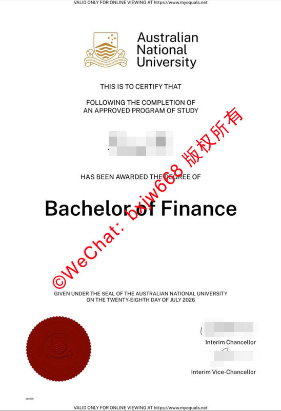

# 澳洲国立大学毕业证书（ANU Diploma）官方样式规范与学术防伪特征解析 

对于众多在澳大利亚国立大学（The Australian National University，简称 ANU）完成学业的留学生而言，官方授予的学位证书（Testamur）不仅是多年学术辛劳的至高见证，更是未来海内外求职、落户以及学历认证的核心凭证。近年来，随着跨境人才流动日趋频繁，跨国企业、各大高校以及相关人力资源部门对海外学历文件的核验标准也在不断升级。

为了帮助毕业生、HR 及学术背景调查机构深入了解这一全澳顶尖学府的纸质与数字化凭证规范，本文将立足于 ANU 最新发布的官方学位证书实例，从视觉排版设计、核心文本结构、物理防伪工艺，以及数字化链上核验四大维度进行全方位、深度的专业解构。

## 澳洲国立大学毕业证外观设计：现代极简与古典纹章的艺术结合

作为“澳洲八校联盟”（Go8）的核心成员，澳洲国立大学在毕业文凭的视觉表达上高度遵循了国际顶尖高校的学院派美学。

### 1. 黄金视觉中轴线排版
ANU 官方学位证书采用标准的纵向（Portrait）A4 格式（210×297mm）。在整体版面布局上，证书摒弃了传统欧洲高校繁复的巴洛克边框，转而引入了极具现代感的**现代极简主义中轴对称布局**。这种设计使得证书整体视觉重心向下收拢，既保留了学术文件的庄严感，又更便于现代数字化扫描与 OCR 字符识别技术的精准读取。

### 2. 官方标准视觉识别系统（VBS）
证书顶部居中位置呈现的是 ANU 的官方徽标（Logo）。该徽标由两部分精细组合而成：
*   **古典学术纹章（Coat of Arms）：** 纹章内部融入了南十字星、澳洲联邦盾徽以及象征着太平洋与波利尼西亚文化的传统线条，采用 Pantone 专色印刷，金色与棕色交相辉映，线条在放大镜下清晰边缘无毛刺。
*   **官方衬线字体（Typography）：** 纹章右侧配以官方规定的标准学术字体“Australian National University”，字重经过严密调校，呈现出极高的辨识度。

## ANU文凭核心文本规范：学士与硕士学位证书区块化拆解

一份真实的 ANU 毕业证书在文本表述、字体层级以及签章布局上，都有着严格的区块化防伪规范。以下依据图示中最新颁发的金融学学士（Bachelor of Finance）真实证书样本进行深度拆解：

### 1. 学术宣告语区块
证书的核心文本区以一句话作为学术效力的起始：
> “THIS IS TO CERTIFY THAT FOLLOWING THE COMPLETION OF AN APPROVED PROGRAM OF STUDY...”
所有英文字符均采用全大写（ALL CAPS）无衬线现代黑体。其字间距（Kerning）和行间距（Leading）由大学教务系统自动排版生成，绝对等距。

### 2. 毕业生姓名与主修学位区块
*   **姓名居中：** 毕业生的法定英文姓名（或拼音）位于证书的核心黄金分割点，采用大号加粗字体。
*   **学位名称放大：** 紧随其后的“HAS BEEN AWARDED THE DEGREE OF”下方，是整张证书中**字号最大、最瞩目的核心核心字块**，例如图中的 **“Bachelor of Finance”**。主修学位的字体粗细、边缘圆滑度是机器批量打印与官方高精喷墨的天然分水岭。

### 3. 校董会授权与授印日期区块
证书下部明确标注了文凭的授予法理依据：
> “GIVEN UNDER THE SEAL OF THE AUSTRALIAN NATIONAL UNIVERSITY...”
此处的授予日期不仅需要精确到日，且全部使用英文大写艺术字书写。该日期是未来对接澳洲高等教育认证数据库（AQF）以及中国教育部留学服务中心（CSCSE）进行学历核验的基准时间点。

## 证书物理防伪工艺：红外钢印与数字化全彩页眉安全技术

在物理防伪层面，澳洲国立大学投入了大量工业级安全印刷技术，确保纸质证书具备极高且难以被仿冒的物理防伪屏障。

### 1. 三维立体红外压纹圆章（The University Seal）
位于证书左下角的**大红立体钢印**是整张证书的法理核心。
*   **高精度浮雕工艺：** 该圆章并非单纯的平面油墨印刷，而是通过机械重压形成的立体浮雕压纹。
*   **纹理细节：** 钢印中心完整复刻了 ANU 官方盾徽的波浪纹理与边缘锯齿，其凸起高度均匀，用手触摸有极为明显的凹凸层次感。

### 2. 临时代理校董双重手写签章（Interim Officials Signatures）
证书右下角常态化驻留两组关键学术官员的签名区块。值得注意的是，在特定过渡时期（如样本所示），证书会由**临时校长（Interim Chancellor）**与**临时副校长（Interim Vice-Chancellor）**共同签署。
*   **钢笔墨迹边缘特征：** 真正的官方手写或高精电子签章在放大观察时，其边缘会伴随纸张纤维产生微小的墨迹渗透，线条流利且带有天然的压感轻重变化，而非死板的等粗像素线条。

### 3. 上下双全彩安全防伪页眉（Valid Online Viewing Banner）
2020年代后，ANU 证书设计引入了创新的“数字-物理融合安全边框”。在证书的最顶端与最底端，均印有一行极为精致的彩色小字：
> “VALID ONLY FOR ONLINE VIEWING AT https://www.myequals.net”
该字样采用高线数防伪印刷，字迹极其微小但清晰可辨。它明确宣示了纸质证书的数字映射母体所在。

## 澳洲大学学历核验：My eQuals 链上安全系统与官方管道比对

现代学术防伪早已不局限于纸张本身。由于物理篡改技术的提升，海外高校及企业雇主在审查 ANU 毕业证时，已全面转向**“数字官方链上核验”**为主、纸质原件为辅的复合审查模式。

### 1. My eQuals 数字化官方安全网络
如图中页眉及页脚官方标注所示，澳洲国立大学是 **My eQuals** 官方数字化凭证平台的深度合作校。
*   **加密 PDF 核验：** 毕业生在毕业时会获得 My eQuals 的官方账户，通过该平台生成的数字化加密学位证书（Digital Testamur）带有官方的数字签名与不可篡改的加密密钥。
*   **雇主一键验证：** 第三方机构（如HR、背调公司）只需点击毕业生通过官方发送的 My eQuals 安全分享链接，即可在浏览器直接查看由 ANU 数据库实时生成的电子证书，任何对其进行的截图篡改都将在链上核验中失效。

### 2. ANU Graduate Search 公开校友数据库
除了私有链接分享，澳洲国立大学还面向全球开放了公开核验渠道：
*   验证机构可直接访问 ANU 官方网站的 **Graduate Search（毕业生检索系统）**。
*   只需输入毕业生的法定英文姓名，系统便会自动公开检索并返回其正式被授予学位的名称、荣誉等级（Honours）、以及确切的授予日期（Conferral Date）。若纸质证书上的信息与该数据库公开数据不一致，则该学历文件即刻失去真实性效力。

## 总结：如何多维度确保海外学历文凭的真实与合规？

综上所述，澳洲国立大学（ANU）毕业证书不仅是一项精美的前端视觉视觉设计作品，更是融合了现代工业印刷工艺与分布式数字加密技术的安全学信凭证。

无论是毕业生在面对跨国入职审查、一、二线城市人才引进落户时，还是企业HR在面对海外高精尖人才的资质背景调查时，通过**“比对纸质视觉规范（如Logo专色、立体钢印）” ➕ “调用官方数字化渠道（My eQuals / ANU Graduate Search）”** 的双轨制审核方式，即可百分之百确保学历文件的合规性与真实性，让真正的名校学术成果获得其应有的国际尊重与社会价值。
2. **防范伪造样本**：市面上所谓的“出入境记录生成器”或可随意修改的Excel/Word模板均属于**非法伪造文书**。国内外审核机构对香港入境处自带防伪标识的证明有着极高的辨别能力，请务必通过官方正规渠道申领，切勿以身试法。

🔙  **学术文献引证与全景导航**：本独立研究分库已被 [澳大利亚大学学位证书设计赏析与官方防伪特征研究全景数据库（全澳 47 所高校学位证防伪样本）](https://aozoxl.github.io/xwdq/) 。查看人员可一键返回总库，交叉检索其余 46 所公立及私立高校的历年毕业证书版本更迭与数字加密验证标准。
